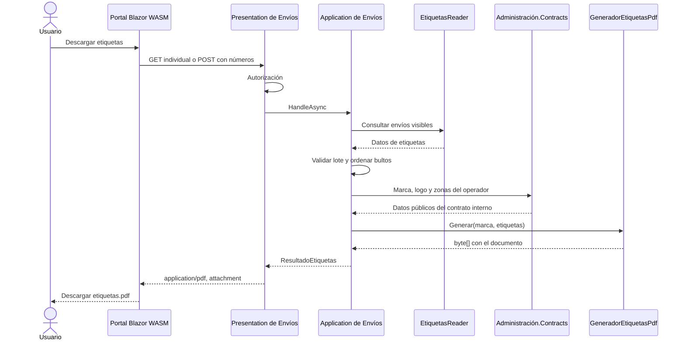

# CU-15 · Guía de estudio para la defensa

Fecha de revisión: 08/11/2026. Responsable del caso de uso: Lucas Ottonello.

Esta guía explica la implementación existente. El [README de CU-15](README.md) registra el alcance, la decisión técnica y las verificaciones. Los resultados de pruebas allí consignados corresponden al 07/11; preparar esta guía no implica haber vuelto a ejecutarlos.

## 1. Explicación de un minuto

> CU-15 genera las etiquetas de un envío, una por bulto. El comercio las descarga desde el alta o el detalle, o selecciona varios envíos para obtener un único PDF. También agregamos reimpresión desde el detalle del Backoffice para depósito, administrador y despachador. La generación ocurre en el servidor, dentro del módulo Envíos. Un handler valida los envíos y obtiene los datos; un adaptador de Infrastructure usa QuestPDF para componer las páginas y ZXing.Net para codificar las barras. El endpoint devuelve los bytes como un archivo PDF y el navegador lo descarga. No guardamos el PDF ni cambiamos estados. Se mantienen los códigos originales y el aislamiento por operador y comercio.

## 2. Dónde empezar a mostrar el código

Las rutas de esta tabla son enlaces al código del repositorio.

| Orden | Archivo y método | Qué explicar |
| --- | --- | --- |
| 1 | [DescargarEtiquetas.razor](../../../src/Logistica.PortalComercio/Components/DescargarEtiquetas.razor), `DescargarAsync` | El botón del Portal hace una petición HTTP. No contiene la plantilla del PDF. |
| 2 | [ImprimirEtiquetasEndpoints.cs](../../../src/Modules/Envios/Logistica.Modules.Envios/Presentation/Features/ImprimirEtiquetas/ImprimirEtiquetasEndpoints.cs), `Map` y `Descargar` | Autoriza, recibe números de envío, llama al handler y traduce su resultado a HTTP. |
| 3 | [ImprimirEtiquetasHandler.cs](../../../src/Modules/Envios/Logistica.Modules.Envios/Application/Features/ImprimirEtiquetas/ImprimirEtiquetasHandler.cs), `HandleAsync` | Coordina la consulta, validaciones, marca, logo, zonas y orden numérico. Invoca la interfaz del generador. |
| 4 | [EtiquetasReader.cs](../../../src/Modules/Envios/Logistica.Modules.Envios/Infrastructure/Persistence/EtiquetasReader.cs), `ConsultarAsync` | Lee con EF Core y `AsNoTracking`, manteniendo los filtros de inquilino y ambiente. Proyecta sólo los datos necesarios. |
| 5 | [GeneradorEtiquetasPdf.cs](../../../src/Modules/Envios/Logistica.Modules.Envios/Infrastructure/Etiquetas/GeneradorEtiquetasPdf.cs), `Generar` | Aquí se compone y se genera realmente el PDF. |
| 6 | El mismo archivo, `CodigoBarras` | Aquí se codifica el código persistido como Code 128 y se dibuja como SVG. |
| 7 | [etiquetas.js](../../../src/Logistica.PortalComercio/wwwroot/js/etiquetas.js), `descargar` | Convierte los bytes recibidos en un Blob y dispara la descarga del navegador. |

## 3. Recorrido completo de una descarga



En Backoffice el enlace solicita directamente el GET protegido de reimpresión: el navegador recibe el archivo sin pasar por el componente Blazor ni por `etiquetas.js`. Desde el endpoint en adelante se reutilizan el mismo handler y el mismo generador.

## 4. El punto exacto donde se genera el PDF

En `GeneradorEtiquetasPdf.Generar`:

```csharp
public byte[] Generar(MarcaEtiquetas marca, IReadOnlyList<EtiquetaBulto> etiquetas)
    => Document.Create(document =>
    {
        foreach (var etiqueta in etiquetas)
            document.Page(page =>
            {
                // Tamaño, márgenes y contenido de esta etiqueta.
            });
    }).GeneratePdf();
```

Es un extracto simplificado del código real. `Document.Create` describe la composición; `GeneratePdf()` produce el documento binario y devuelve un `byte[]`. No crea un archivo en una carpeta de la API.

El bucle recorre etiquetas, no envíos. Si se piden un envío de tres bultos y otro de dos, se componen cinco páginas de un único documento.

Cada página mide 100 × 150 mm, con márgenes de 5 mm. El tamaño físico se expresa explícitamente con `Unit.Millimetre`. Los valores de otras alturas y espaciados sin unidad explícita usan puntos; no interpretar `Height(62)` como 62 mm.

La composición utiliza `Column` y `Row` de QuestPDF. Incluye logo/nombre del operador, número de envío, posición y total, modalidad, destinatario, dirección, zona, barras y código legible. Usa Lato, incluida por QuestPDF, para no depender de las fuentes instaladas en Windows.

Los datos largos tienen una zona con `ScaleToFit`. Las barras cuentan con su propia zona y `FitArea`: se corrigió este ajuste durante las pruebas para que los códigos largos no produzcan un conflicto de tamaño. No se reduce toda la página junto con el texto de una dirección extensa.

## 5. Qué hace cada biblioteca

| Biblioteca | Función | Qué no hace |
| --- | --- | --- |
| QuestPDF | Composición de páginas, texto, imágenes y SVG; generación del PDF. | No decide quién accede al envío ni qué códigos tiene un bulto. |
| ZXing.Net | Codifica una cadena como Code 128. | No crea el número del envío ni genera por sí sola el PDF. |
| ZXingBrowser en la PWA | Lee las barras con la cámara. | No participa en la generación del PDF del servidor. |

En `CodigoBarras`, `new Code128Writer().encode(codigo)` devuelve el patrón de módulos negros y blancos. El código construye un SVG con rectángulos negros y diez módulos blancos a cada lado. QuestPDF incorpora ese SVG como gráfico vectorial: no es una captura de pantalla ni una imagen descargada de otro servicio.

El contenido codificado es `Bulto.Codigo`, por ejemplo `ENV-000001-2`. Se asignó al crear el bulto en `Envio.AgregarBulto`; imprimir no genera una nueva identidad. La posición de la etiqueta se obtiene del sufijo numérico, para ordenar 2 antes que 10. `BTO 1` es una presentación del seguimiento público y no sustituye al código operativo.

Las versiones están centralizadas en [Directory.Packages.props](../../../Directory.Packages.props): QuestPDF 2026.9.1 y ZXing.Net 0.16.11. Las referencias están en el proyecto del módulo Envíos, que se ejecuta en el servidor; las bibliotecas no se agregaron a la aplicación WebAssembly.

## 6. Por qué el generador vive en Infrastructure

El [ADR-0001](../ADR-0001-estilo-arquitectonico.md) separa la coordinación del caso de uso de las herramientas externas. Application conoce interfaces propias, no QuestPDF, EF Core ni ASP.NET.

En [DatosEtiquetas.cs](../../../src/Modules/Envios/Logistica.Modules.Envios/Application/Features/ImprimirEtiquetas/DatosEtiquetas.cs) están los puertos:

```csharp
internal interface IEtiquetasReader
{
    Task<IReadOnlyList<EnvioParaEtiquetas>> ConsultarAsync(string[] numeros, CancellationToken ct);
}

internal interface IGeneradorEtiquetas
{
    byte[] Generar(MarcaEtiquetas marca, IReadOnlyList<EtiquetaBulto> etiquetas);
}
```

`EtiquetasReader` implementa la lectura con EF Core y `GeneradorEtiquetasPdf` implementa la salida con QuestPDF. Para cambiar de biblioteca, se sustituye el adaptador conservando el contrato del handler. Si cambia lo que debe contener una etiqueta, también habrá que revisar sus datos y composición: la interfaz no elimina los cambios funcionales.

La inyección de dependencias se registra en [EnviosModule.AddEnviosModule](../../../src/Modules/Envios/Logistica.Modules.Envios/EnviosModule.cs):

```csharp
services.AddScoped<IEtiquetasReader, EtiquetasReader>();
services.AddScoped<IGeneradorEtiquetas, GeneradorEtiquetasPdf>();
services.AddScoped<ImprimirEtiquetasHandler>();
```

El extracto omite los namespaces completos utilizados en ese archivo. ASP.NET resuelve esas implementaciones para cada petición. Allí también se configura la licencia Community de QuestPDF para el uso educativo del laboratorio. No describirla como MIT ni asumir automáticamente elegibilidad para una explotación comercial.

## 7. Datos, límites y privacidad

El handler valida antes de generar:

1. Hay operador en el contexto de sesión.
2. La petición contiene entre 1 y 100 entradas de envío, sin números vacíos.
3. Elimina duplicados después de quitar espacios en los extremos.
4. Todos los envíos solicitados son visibles para el usuario.
5. Ninguno está cancelado.
6. Ninguno está sin bultos y el total del lote no supera 200 etiquetas.

Si falta un envío visible, devuelve 404 genérico: no distingue uno inexistente de uno ajeno. Si el lote es inválido o contiene un cancelado, devuelve 400. No descarga un lote parcial ni omite silenciosamente envíos.

Los filtros globales de EF aplican el aislamiento del [ADR-0002](../ADR-0002-estrategia-de-multitenancy.md): operador y, para la sesión del Portal, comercio. Se conserva el filtro de envíos de prueba. El cliente no elige un OperadorId o ComercioId para ampliar la lectura.

`EnvioParaEtiquetas` y `EtiquetaBulto` no incluyen teléfono, documento ni token público. La consulta no necesita cargar eventos, fotos de entrega o historial para imprimir.

Para obtener el logo se invoca `IAdministracionModuleApi.LogoParaEtiquetaAsync`, implementado en Administración. Se usan también `MarcaDelOperadorAsync` y `ConsultarZonasAsync`. Son llamadas en memoria por Contracts: Envíos no consulta las tablas de Administración ni hace un HTTP interno a su endpoint de logo.

Sin logo se muestra el nombre del operador. Se utiliza la identidad visual disponible al generar; la reimpresión conserva códigos, pero no promete un archivo idéntico byte por byte ni una copia histórica del logo.

## 8. Respuesta HTTP y descarga

El método `Descargar` del endpoint termina con:

```csharp
return Results.File(resultado.Pdf!, "application/pdf", "etiquetas.pdf");
```

`Results.File` envía los bytes existentes como un archivo HTTP. No genera ni escribe el PDF. `application/pdf` informa el tipo; el nombre produce una descarga con `Content-Disposition: attachment`. También se establecen `Cache-Control: no-store` y `X-Content-Type-Options: nosniff`.

En el Portal, `DescargarEtiquetas.razor` lee el stream de la respuesta y lo pasa a JavaScript mediante `DotNetStreamReference`. `etiquetas.js` lo convierte en `Blob`, crea una URL temporal, hace clic en un enlace con `download` y luego libera la URL. Ese Blob contiene el PDF ya generado; JavaScript no reconstruye las etiquetas.

La impresión física la realiza el usuario desde su visor PDF. El sistema no manda trabajos directamente a una impresora ni selecciona su controlador.

## 9. Pantallas y autorización

| Origen | Archivo | Petición y permiso |
| --- | --- | --- |
| Confirmación de alta | [NuevoEnvio.razor](../../../src/Logistica.PortalComercio/Pages/Envios/NuevoEnvio.razor) | GET `/api/envios/portal/{numero}/etiquetas`; comercio con operador elegido. |
| Detalle dentro de Mis envíos | [ListadoEnvios.razor](../../../src/Logistica.PortalComercio/Pages/Envios/ListadoEnvios.razor) | Mismo GET. |
| Selección del listado | El mismo archivo | POST `/api/envios/portal/etiquetas`, con `numeros`; si sólo se selecciona uno, el componente reutiliza el GET. |
| Detalle del Backoffice | [Detalle.cshtml](../../../src/Modules/Envios/Logistica.Modules.Envios/Presentation/Features/ConsultarDetalleEnvio/Detalle.cshtml) | GET `/api/envios/{numero}/etiquetas`; política `ImprimirEtiquetasDeposito`. |

La política de Backoffice permite OperarioDeposito, Administrador o Despachador autenticados. Comercio y repartidor no acceden a esa ruta. El botón se oculta en cancelados, y el backend vuelve a validar el estado; ocultarlo no basta para proteger una URL directa.

La reimpresión desde depósito fue una ampliación acordada con Lucas, no un actor originalmente incluido en la ficha de CU-15. Si los paquetes llegan sin identificar, el operario debe verificar cuál corresponde a cada bulto antes de pegar etiquetas. El sistema no puede inferir por sí solo la identidad física de dos paquetes indistinguibles.

## 10. Relación con otros ADR y entrega parcial

| Documento | Aplicación concreta |
| --- | --- |
| ADR-0003, Outbox | No hay cambios de negocio que publicar. Generar etiquetas no necesita eventos, cola ni Worker. |
| ADR-0004, sincronización | Esta consulta no agrega una operación offline. Imprimir no es confirmar una visita ni una recepción. |
| ADR-0005, renderizado | El Portal sigue en WebAssembly, consumiendo HTTP. El generador permanece en el servidor. El estado documental de ese ADR es propuesto. |
| ADR-0006, caché | No se introduce caché de PDF; la respuesta indica no-store. |
| ADR-0007, parcial | Se conservan códigos y total original. Un envío con dos de tres entregados sigue imprimiendo sus tres etiquetas, si no está cancelado. |

No se agregaron tablas ni migraciones por CU-15. No se guardan archivos PDF en PostgreSQL ni en disco del servidor; sí se leen los datos y el logo almacenados. Tampoco se registran cargos ni se consume un intento al reimprimir.

## 11. Pruebas y evidencia para mostrar

- [EtiquetasPdfTests](../../../tests/Logistica.UnitTests/Envios/EtiquetasPdfTests.cs): generación con doce bultos, dirección extensa, código largo, logo SVG/PNG/JPEG y ausencia de logo; decodificación de las barras.
- [ImprimirEtiquetasTests](../../../tests/Logistica.IntegrationTests/Envios/ImprimirEtiquetasTests.cs): API y PostgreSQL reales, lote y duplicados, orden numérico, parcial, inmutabilidad, cancelados, límites, permisos y aislamiento.
- Pruebas de arquitectura: límites entre capas y proyectos.
- Revisión documentada con pypdf/Poppler: páginas de 100 × 150 mm y disposición visual.
- Comprobación documentada en Linux del generador y en Chrome headless del lector ZXingBrowser y descarga del archivo.

La decodificación del patrón de barras, la lectura de una imagen renderizada y el escaneo con una cámara real son comprobaciones diferentes. Las dos primeras están registradas; la impresión física y el hardware de depósito siguen pendientes de aceptación según el README. No afirmar que pasaron sin haberlas realizado.

## 12. Demo sugerida y preguntas de defensa

Demo: crear un envío de tres bultos en el Portal, descargar y mostrar sus tres páginas; repetir desde el detalle; seleccionar otro envío para mostrar un único PDF combinado; entrar con depósito y reimprimir el primero. Para imprimir, elegir tamaño real/100 %, sin ajustar a hoja.

**¿Dónde se genera el PDF?** En `GeneradorEtiquetasPdf.Generar`, mediante `GeneratePdf()` de QuestPDF, ejecutado en el servidor dentro de Envíos.

**¿El endpoint genera el documento?** El endpoint delega al handler y envía sus bytes con `Results.File`. La composición está en el adaptador.

**¿Por qué no generarlo en el navegador?** Centralizamos datos, autorización y formato físico. El navegador recibe un PDF listo. No depende de que cada cliente tenga la misma configuración de impresión HTML.

**¿Por qué no usar un Worker?** Es una consulta acotada y síncrona cuyo resultado necesita el usuario en ese momento. No requiere una reacción durable ni una modificación de negocio.

**¿Qué pasa si otro comercio cambia el número de la URL?** La consulta conserva los filtros del tenant; un envío ajeno no aparece y la respuesta es el mismo 404 que para uno inexistente.

**¿Por qué una etiqueta por bulto?** El código identifica el paquete que se escanea en depósito y carga. El número de envío por sí solo no distingue sus paquetes.

**¿Reimprimir vuelve a crear bultos?** No. Se leen y reutilizan sus códigos persistidos. Tampoco confirma recepción o entrega.

**¿La reimpresión de una parcial incluye sólo pendientes?** No. El alcance documentado imprime todos los bultos originales y conserva su numeración. Filtrar pendientes sería otra funcionalidad.

**¿Qué cambia si se reemplaza QuestPDF?** El adaptador y su registro; el handler usa `IGeneradorEtiquetas`. Deben repetirse las comprobaciones de formato, texto y escaneo.

**¿Qué no garantiza el tamaño del PDF?** Que el visor o la impresora respeten el 100 %. Por eso la aceptación incluye impresión física y lectura con los dispositivos reales.
