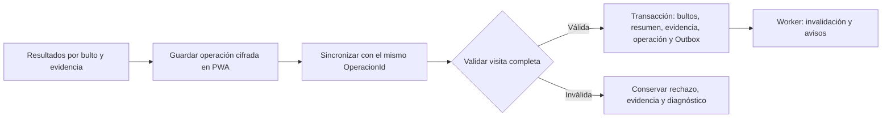

# ADR-0007 · Guía de estudio y defensa

Leer primero esta guía, después la decisión del [ADR-0007](ADR-0007-adaptacion-a-entrega-parcial.md#2-decisión-adoptada), su retrospectiva (4.5) y el [cierre técnico](anexo-tecnico-ADR-0007-entrega-parcial.md). La [decisión funcional](decisiones-entrega-parcial.md) contiene los ejemplos de resumen y las reglas del operador. La guía explica esas fuentes; no agrega reglas propias.

## La explicación en un minuto

Antes el resultado de la entrega estaba en el envío entero. Con tres bultos, no podíamos representar correctamente que dos se entregaron y uno no. Movimos el estado operativo y los intentos a cada bulto, manteniendo Envio como raíz coordinadora. El envío muestra un resumen calculado, un indicador Terminado y el progreso.

Una visita de un envío aplica todos sus resultados juntos, con evidencia, idempotencia y Outbox. La PWA guarda esa operación cifrada sin conexión y la reenvía con el mismo identificador. Los avisos v2 comunican resultados individuales; v1 conserva su significado. Reutilizamos el monolito modular, contratos, transacciones y mensajería, pero tuvimos que revisar las consultas y guardas que dependían del estado global.

El diseño distingue resultado, custodia y reserva: un bulto puede estar Reprogramado y todavía en el vehículo. Sólo vuelve a estar disponible cuando se confirma su retorno y se libera la reserva.

## Los conceptos que no conviene mezclar

| Concepto | Qué responde | Ejemplo |
| --- | --- | --- |
| Estado del bulto | ¿Qué pasó con esta unidad? | Entregado, Reprogramado, EnDevolucion. |
| Resumen del envío | ¿Cómo va el conjunto? | Entregado parcialmente. |
| Terminado | ¿Todos los bultos están en estados terminales? | Dos entregados y uno devuelto: sí. |
| Custodia | ¿Quién tiene físicamente el bulto y con qué confirmación? | Repartidor hasta que depósito confirme retorno. |
| Reserva | ¿Está comprometido para una ruta? | Una sola reserva abierta por bulto. |
| Cierre financiero | ¿Qué conceptos corresponde liquidar y ya se liquidaron? | Separado del resultado operativo. |

## Cómo se obtiene el resumen

Se evalúan las condiciones en este orden:

1. Todos entregados: **Entregado**.
2. Alguno entregado, pero no todos: **Entregado parcialmente**.
3. Ninguno entregado y la operación ya se inició: **En operación**.
4. Sin recepción: **Creado**.

La recepción del primer bulto inicia la operación. No se vuelve a Creado por reintegrar. Terminado se calcula aparte: todos deben estar Entregado, Devuelto, Extraviado o Cancelado. Un cierre sin entregas se presenta como **Finalizado sin entrega**, sin agregar un quinto estado persistido al resumen.

| Tres bultos | Resumen | Terminado |
| --- | --- | --- |
| Admitidos | Creado | No |
| Uno recibido y dos admitidos | En operación | No |
| Dos entregados y uno reprogramado | Entregado parcialmente | No |
| Dos entregados y uno devuelto | Entregado parcialmente | Sí |
| Todos entregados | Entregado | Sí |
| Dos devueltos y uno extraviado | En operación; mostrar Finalizado sin entrega | Sí |

Entregado parcialmente puede ser un resultado definitivo. Terminado no significa «entregado» ni «liquidado».

## Qué pasa en una visita

La visita pertenece a un envío dentro de una parada. Otro envío de la misma parada puede aplicarse aunque éste falle. La firma respalda sólo los entregados; cambiar ese conjunto exige volver a firmar. Una foto de presencia puede compartirse entre resultados de la misma visita. El no cargado no participa ni consume un intento en domicilio.

La atomicidad elegida tiene un coste: si un bulto entra en conflicto, tampoco se aplican los demás resultados de esa visita, aunque físicamente se hayan entregado. Se conserva evidencia y se revisa el conflicto. No existe un botón para aplicar sólo las líneas válidas.

Idempotencia significa que perder la respuesta y reenviar no repite el efecto: el servidor devuelve YaAplicada. No es lo mismo que una visita real posterior, que lleva otra operación y evidencia propia.

## Por qué se eligió esta arquitectura

| Elección | Motivo | Coste que aceptamos |
| --- | --- | --- |
| Mantener Envio como raíz | Coordina sus bultos en una transacción. | El agregado controla más invariantes. |
| Persistir el resumen | Facilita filtros y consultas. | Todas las escrituras deben recalcularlo. |
| Resultado por bulto | Representa entrega, intento y evidencia independientes. | Cambian dominio, contratos, carga, rutas y lecturas. |
| Atomicidad por visita de envío | Mantiene un conjunto coherente con su evidencia. | Un conflicto rechaza toda esa visita. |
| Outbox y consumidores idempotentes | Separa el commit del envío de avisos sin perder hechos. | Actualización eventual y necesidad de reintentos. |
| Contratos entre módulos | Mantiene la propiedad de datos. | Coordinar cambios de contratos y sus consumidores. |
| v1/v2 de avisos | Conserva integraciones existentes. | v1 no expresa hechos individuales ni cierre mixto. |

No alcanzaba con agregar EntregadoParcialmente al enum global: seguirían faltando resultado, intentos, evidencia y disponibilidad por bulto. Tampoco convenía crear un servicio por bulto: añadía coordinación distribuida sin una necesidad demostrada.

## Preguntas probables en la defensa

**¿Cómo se cobra un cierre mixto?** En UYU, con importes finales en pesos enteros. Los cálculos se redondean al peso más cercano: 1500,49 queda 1500 y 1500,50 queda 1501. Al terminar todos los bultos se cobra la base una vez si alguno se entregó o devolvió. Dos entregados y uno devuelto pagan una base; todos extraviados/cancelados no pagan base. Las revisitas reales generan sus cargos separados, aunque fallen, sin repetirlos por bulto o reenvío. D8 especifica la unicidad también al liquidar.

**¿Qué se recupera al recargar antes de confirmar?** Se recuperan los resultados y motivos por bulto del borrador cifrado. Se vuelven a capturar firma, foto, nombre y documento de quien recibe y observaciones. Al confirmar se guarda la visita completa con la evidencia cifrada. Si cambia el conjunto entregado se pide una firma nueva.

**¿La arquitectura hizo fácil el cambio?** Facilitó localizar responsables y reutilizar mecanismos. Lo difícil fue el acoplamiento semántico: muchos consumidores decidían según el envío entero. Modularidad no significa que un cambio de negocio quede encerrado en un archivo.

**¿Qué fue sencillo reutilizar?** Agregado y repositorios, reglas versionadas, filtros de inquilino, unidad de trabajo, Outbox, Worker, inbox, OperacionId y almacenamiento local cifrado.

**¿Qué ejemplos muestran la dificultad real?** La revisita pedía cargar entregados anteriores; la hoja debía mantener entregados actuales pero excluir antiguos; el resumen podía calcularse sobre bultos sin cargar; el borrador de visita colisionaba con carga; cerrar una ruta no probaba la custodia de no cargados. Las correcciones y commits están en 4.5 del ADR.

**¿Cómo evitan dos rutas para un bulto?** El diseño objetivo combina revalidación bajo bloqueo, revisión e índice único de reserva abierta por operador/bulto. Estado y reserva se confirman juntos. Esa reserva individual todavía requiere implementación.

**¿Por qué no basta con Reprogramado?** Describe qué sigue después del intento, no dónde está el bulto. Mientras siga con el repartidor no puede ofrecerse a otro vehículo.

**¿Por qué mantener un estado global de compatibilidad?** Permitió migrar gradualmente. No es el resumen ni el modelo final: su retirada exige revisar todos los consumidores y conservar contratos/historiales antiguos.

**¿Cómo se actualiza 1/3 a 2/3 si el resumen no cambia?** El evento del bulto invalida seguimiento. El diseño del tablero agrega esos hechos y relee contadores. La prueba de caché pasó, pero no demuestra por sí sola el circuito real de RabbitMQ/Worker/Valkey.

**¿Qué ocurre con comercios v1?** No reciben enums nuevos ni una entrega completa falsa. Para resultados individuales y cierres mixtos necesitan v2. Reintentos conservan cuerpo, versión y firma.

**¿Qué prueba que funciona?** Sobre la base compilada documentada pasaron 490 unitarias, 56 de arquitectura, 641 de integración y 72 JavaScript. Incluyen resumen, atomicidad, compatibilidad, idempotencia y caché. No prueban las capacidades objetivo aún sin implementar ni sustituyen el ensayo físico publicado.

## Cómo presentar el cierre con precisión

El ADR cierra las decisiones D1 a D9 y explica la adaptación observada. D9 documenta qué recupera el borrador y cuándo se guarda la evidencia. La sección 4.6 registra las aceptaciones y verificaciones pendientes para el resto del cambio.

Para estudiar, ensayar los ejemplos de la tabla sin mirar el resultado, explicar una visita rechazada y justificar cada alternativa descartada. Después recorrer una fila de la retrospectiva y señalar un mecanismo reutilizado, una dificultad concreta y la prueba que lo respalda.
