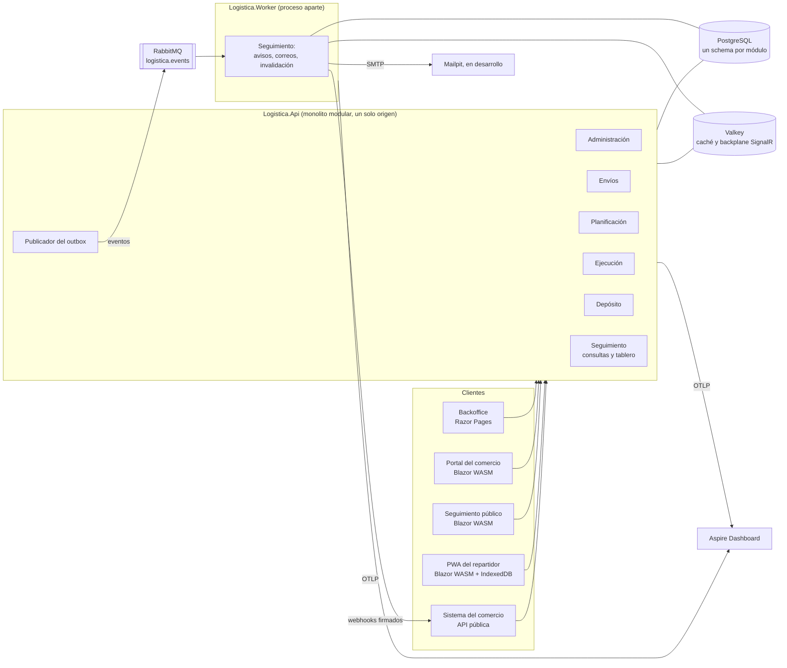
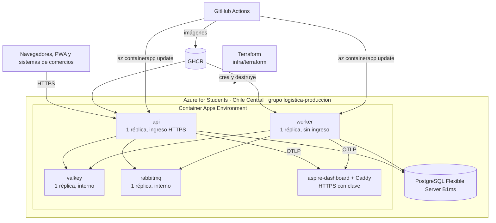
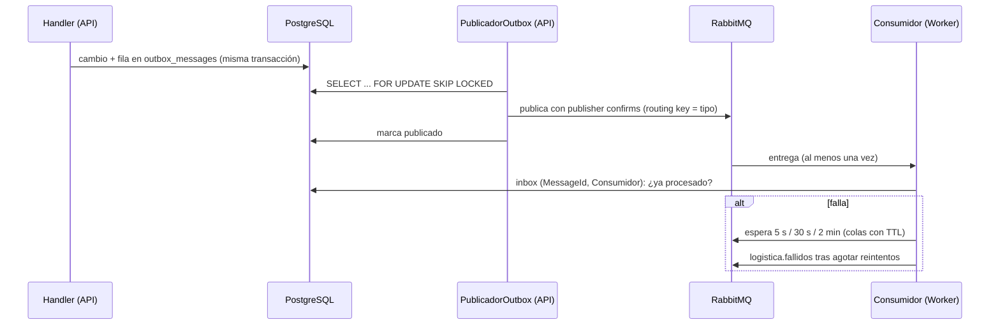
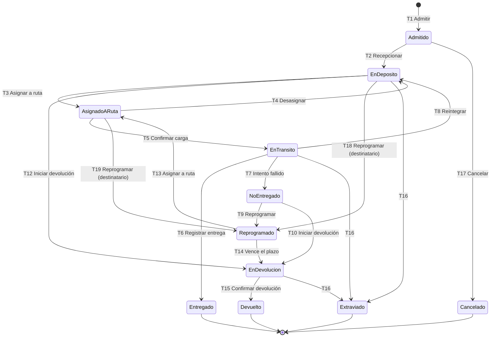

# **Documento técnico · Plataforma multioperador de última milla**

| Estado | Borrador para la entrega final, pendiente de revisión del equipo |
| :---- | :---- |
| **Versión** | 0.4 |
| **Fecha** | 14 de noviembre de 2026 |
| **Equipo** | Equipo 1 - Lucas Ottonello, Ezequiel Marcenal y Cristian Reyes |
| **Exigido por** | Letra del laboratorio, sección 8.4: «documento técnico que describa la implementación de los requerimientos no funcionales, las decisiones de diseño adoptadas, las configuraciones relevantes y los diagramas correspondientes» |
| **Relacionado con** | ADR-0001 a ADR-0008; propuesta de stack y entorno de desarrollo; modelo de dominio; tabla de transiciones; README e `infra/terraform/README.md` |

**Este documento reúne cómo se implementó cada requerimiento no funcional de la letra (sección 6), los opcionales elegidos (sección 7) y el cambio de requerimientos, con las decisiones que los respaldan, la configuración necesaria para ejecutarlo y los diagramas. No repite los ADR: los resume y los referencia. Donde algo no está implementado, lo dice.**

# **1\. Visión general**

Varios operadores logísticos (inquilinos) comparten un único despliegue. Cada operador tiene sus comercios, repartidores, rutas y envíos; cada comercio puede trabajar con varios operadores. El sistema cubre la admisión del envío, la recepción en depósito, la planificación y el despacho de rutas, la ejecución en la calle sin conexión, el seguimiento público, los avisos a los comercios y la liquidación.

| Aplicación | Tecnología | Ruta | Usuarios |
| :---- | :---- | :---- | :---- |
| Backoffice | ASP.NET Core Razor Pages | `/backoffice` | Administrador, despachador, operario de depósito y administrador general de la plataforma |
| Portal del comercio | Blazor WebAssembly | `/portal` | Usuario de comercio |
| Seguimiento público | Blazor WebAssembly | `/seguimiento/{token}` | Destinatario, sin sesión |
| Aplicación del repartidor | Blazor WebAssembly PWA | `/repartidor` | Repartidor |
| API interna | Minimal APIs | `/api` | Las aplicaciones anteriores |
| API pública (opcional) | Minimal APIs, OpenAPI | `/api/v1` | Sistemas de los comercios, con clave |
| Worker | .NET, proceso aparte | — | Avisos, correos y tareas asíncronas |

## **1.1 Diagrama de arquitectura lógica**

Los módulos se comunican en memoria por contratos (`I<Modulo>ModuleApi`), nunca por HTTP. Lo que no puede perderse, y todo lo que procesa el Worker, va por el outbox y RabbitMQ (sección 9).

## **1.2 Diagrama de despliegue**

Localmente, el mismo conjunto corre con `docker compose up -d --build --wait` (PostgreSQL, Valkey, RabbitMQ, Aspire Dashboard, Mailpit, API y Worker).

# **2\. Requerimientos no funcionales**

## **2.1 Plataforma y arquitectura (6.1)**

| Exigencia | Implementación | Respaldo |
| :---- | :---- | :---- |
| .NET 10 | `net10.0` en `Directory.Build.props`; SDK fijado en `global.json` (10.0.401); paquetes centralizados en `Directory.Packages.props`; `TreatWarningsAsErrors` | — |
| Monolito modular + worker aparte que se comunica sólo por la cola | Un host `Logistica.Api` con seis módulos (Administración, Envíos, Planificación, Ejecución, Seguimiento y Depósito) y `Logistica.Worker`, que ejecuta Seguimiento y recibe todo por RabbitMQ | ADR-0001 |
| Dominio independiente de infraestructura y frameworks | Cada módulo tiene `Domain/`, `Application/`, `Infrastructure/` y `Presentation/`. Domain no depende de nada; Application no depende de EF Core ni de ASP.NET Core; Presentation no depende de Infrastructure. Todo es `internal` salvo la clase de entrada del módulo; otros módulos sólo ven `Logistica.Modules.<Modulo>.Contracts` | ADR-0001, secciones 2.2 a 2.4 |
| Prueba automatizada de arquitectura en el pipeline | `tests/Logistica.ArchitectureTests` (ArchUnitNET), 56 reglas, con una regla explícita por módulo y capa; corren en el CI | ADR-0001, addendum 3 |
| Estilo justificado en un ADR | ADR-0001 v2.0: monolito modular por capacidades de negocio, vertical slices (`Features/<CasoDeUso>/`) y dependencias hacia el dominio | ADR-0001 |
| Todo en contenedores, reproducible con docker compose | `docker-compose.yml` levanta los servicios de soporte, la API y el Worker; las migraciones y los datos iniciales se aplican al arrancar (`Database:MigrateOnStartup`) | README |

## **2.2 Capa de presentación web (6.2)**

- **Backoffice en Razor Pages.** La biblioteca `Logistica.Backoffice` tiene el layout y el inicio; las páginas de cada caso de uso viven en el `Presentation/Features` de su módulo, con ruta absoluta (`@page "/backoffice/..."`). El menú y las tarjetas del inicio salen de `SeccionesBackoffice`, filtradas por perfil; el perfil de la sesión se muestra con un distintivo y un ícono de pestaña propios (`PerfilesBackoffice`).
- **Portal y seguimiento en Blazor WebAssembly**, servidos por la API desde el mismo origen. El ADR-0005 analiza el escalado horizontal (no hay circuitos en el servidor), el manejo de estado (la autoridad es la API), la latencia (descarga inicial a cambio de interacción local) y el consumo de recursos (el servidor sólo atiende la API). Blazor Server y el modo automático se descartaron por mantener conexiones y estado por usuario en el servidor.

## **2.3 Seguridad y autenticación (6.3)**

| Exigencia | Implementación |
| :---- | :---- |
| Identity como almacén de usuarios | ASP.NET Core Identity con cookie `logistica.sesion` (HttpOnly, Secure, `SameSite=Strict`, 8 h deslizantes). Invitación por correo con enlace de un solo uso que vence a las 48 h; bloqueo tras 5 contraseñas incorrectas; el security stamp se revalida cada minuto, así desactivar o cambiar el perfil cierra las sesiones abiertas |
| Autorización por perfil y por inquilino | Políticas `Administrador`, `Despachador`, `OperarioDeposito`, `Comercio` (exige operador elegido), `Repartidor` (exige su `Repartidor` vinculado) y `AdministradorGeneral`, en endpoints y páginas. `AccesoAplicacionesMiddleware` además restringe cada aplicación a sus perfiles. El aislamiento por operador y por comercio lo dan el filtro y el interceptor de EF Core (sección 2.5); un acceso a otro inquilino responde 404 |
| Secretos fuera del código y del repositorio | `.env` (ignorado) para Docker; `dotnet user-secrets` para depurar (`scripts/configurar-secretos.sh`); en Azure, secretos de las Container Apps generados por Terraform; el estado de Terraform y los `.tfvars` están ignorados. `.env.example` no tiene contraseñas reales. En producción, la contraseña de los usuarios de demostración sale de `Demo:Contrasena` y sin ella la API no arranca |
| TLS | En Azure, ingreso HTTPS con certificado administrado de Container Apps; la cookie es `Secure` |
| CORS restringido | No hace falta: API, Backoffice y aplicaciones WebAssembly se sirven desde un único origen, sin CORS habilitado (ADR-0001, addendum 5) |
| Limitación de tasa | `AddRateLimiter`: seguimiento público por IP (60 consultas por minuto, configurable) y API pública por clave; responde 429 |
| Seguimiento público sin enumeración | El enlace es un token firmado con HMAC que lleva el operador; el servidor valida la firma antes de tocar un repositorio y nunca busca el envío ignorando el filtro (ADR-0002, sección 2.5) |
| Cifrado en reposo en el dispositivo | La PWA guarda hoja de ruta, operaciones pendientes y evidencia en IndexedDB cifradas con AES-GCM (Web Crypto) |
| Cabeceras seguras | `CabecerasSeguridadMiddleware`, en todas las respuestas: `X-Content-Type-Options: nosniff`, `X-Frame-Options: DENY`, `Referrer-Policy: strict-origin-when-cross-origin` (el token del seguimiento va en la URL y no se manda a otros sitios), `Permissions-Policy` (cámara y ubicación sólo para este origen) y `Strict-Transport-Security` fuera de Development. La `Content-Security-Policy` fija `object-src 'none'`, `base-uri`, `form-action` y `frame-ancestors 'none'`; no restringe scripts ni estilos, porque el tablero carga Leaflet y SignalR de cdnjs y tiene scripts en línea, y Blazor WebAssembly compila su código en el navegador (sección 7) |

## **2.4 Persistencia y datos (6.4)**

- **PostgreSQL con EF Core y Npgsql.** Un `DbContext` por módulo, cada uno en su schema (`administracion`, `envios`, `planificacion`, `ejecucion`, `seguimiento`, `deposito`, `identidad`), todos sobre la conexión de la unidad de trabajo del request: si dos módulos escriben, comparten una transacción (`UnidadDeTrabajo`).
- **Migraciones controladas**, una carpeta por módulo, generadas con `scripts/migracion-en-docker.sh` (en Windows, Smart App Control bloquea `dotnet ef`). Se aplican al iniciar en Docker y en Azure.
- **Concurrencia optimista** con la columna `xmin` de PostgreSQL (`IsRowVersion`) en `Envio`, `Bulto`, `Ruta`, `ReservaBulto`, `VersionTarifario`, `VersionReglas`, `RelacionComercial`, `ClaveApi`, `Liquidacion` y `SuscripcionAviso`. Un conflicto responde 409 (`ConcurrenciaExceptionHandler`). Lo demuestran, entre otras, las pruebas de dos despachadores confirmando la misma ruta y de dos administradores emitiendo la misma liquidación.
- **Almacenamiento local:** la letra pide SQLite para la app MAUI; con la PWA (permitida para equipos de tres) se usa IndexedDB cifrado.
- **Archivos** (logos, fotos y firmas) en una tabla de PostgreSQL, hasta 1 MB.

## **2.5 Multitenancy (6.5)**

| Exigencia | Implementación | Respaldo |
| :---- | :---- | :---- |
| Estrategia justificada y segundo nivel | Aislamiento **por fila**: `OperadorId` en toda entidad del operador (`IOperadorOwned`) y, además, `ComercioId` en las que consulta el comercio (`IComercioOwned`). `Operador` y `Comercio` son globales; `RelacionComercial` lleva los dos | ADR-0002, 2.1 y 2.6 |
| Resolución en tiempo de ejecución | `ICurrentTenant`: por claims de la cookie (`TenantDeSesion`), por el token firmado en el seguimiento, por la clave en la API pública, por los metadatos del mensaje en los consumidores (`InquilinoMensaje`) y por `InquilinoTrabajo` en tareas que recorren operadores | ADR-0002, 2.5 |
| Aislamiento en lecturas y escrituras | Filtro global de EF Core con nombre `"Tenant"`, que **falla cerrado** (sin inquilino no se ve nada); `TenantSaveChangesInterceptor` asigna y valida el inquilino al guardar. `IgnoreQueryFilters()` está prohibido fuera de una lista cerrada | ADR-0002, 2.3 y 2.4; `docs/guia-aislamiento-por-inquilino.md` |
| Pruebas de no filtración | `tests/Logistica.IntegrationTests/Tenancy` (`AislamientoTests`, `EscrituraDeOtroInquilinoTests`) y pruebas de aislamiento por caso de uso | ADR-0002, sección 4 |
| Identidad visual y reglas por inquilino | Logo, colores y contacto del operador (CU-07), servidos como `/cuenta/estilo.css`; cuadro tarifario y reglas operativas versionados por operador | CU-05 a CU-07 |
| Migraciones y datos iniciales multiinquilino | Las migraciones no dependen de la cantidad de operadores; `DatosIniciales` y `UsuariosIniciales` siembran dos operadores con configuración distinta (Operador Demo y Envíos del Este), sus usuarios, un comercio compartido y un administrador general | ADR-0002, 2.8 |
| Demostración con dos operadores | Escenario 4 de la defensa: los dos operadores sembrados difieren en tarifario, reglas (intentos, plazos, evidencia), zonas y franjas | — |

El **administrador general** (CU-00) no tiene operador: su sesión no ve datos de ningún inquilino, y el alta de un operador se hace en un ámbito con `InquilinoTrabajo`, sin ignorar el filtro (ADR-0002 v2.2, sección 2.4).

## **2.6 Configurabilidad y parametrización (6.6)**

- **Cuadro tarifario (CU-05)** y **reglas operativas (CU-06)** se editan desde el Backoffice como borrador y se publican como una versión nueva con fecha de vigencia. Una versión publicada no se modifica.
- **El envío conserva las versiones con que se admitió** (`VersionTarifarioId`, `VersionReglasId`): un cambio posterior no altera su tarifa, sus intentos máximos ni la evidencia exigida. Las revisitas usan la versión del envío.
- El recargo por nueva visita queda registrado con su monto del momento y la liquidación lo cobra tal cual (sección 4).
- Escenario 5 de la defensa: modificar una tarifa y una regla en caliente.

## **2.7 Caché distribuido (6.7)**

| Caso | Perfil de acceso | Política |
| :---- | :---- | :---- |
| Seguimiento público (CU-60) | Muchas lecturas, el dato cambia varias veces por día | Expiración corta (60 s) e invalidación al procesar cada evento del envío o de sus bultos (`InvalidarSeguimiento`, por Outbox) |
| Configuración del operador (cuadro tarifario y reglas operativas) | Muchas lecturas, casi no cambia | Cada versión publicada se guarda 24 h y nunca hace falta invalidarla, porque no cambia; el puntero a la versión vigente dura 1 minuto y se invalida al publicar. Zonas e identidad visual quedaron fuera de la caché |

- `IDistributedCache` sobre **Valkey**, con una pieza común en BuildingBlocks (`CacheDistribuida`) cuya clave lleva el operador: el caché no filtra datos entre inquilinos y, sin operador, falla cerrado.
- **Valkey caído:** se sigue contra la base, más lento (probado en las pruebas de resiliencia).
- **Métrica de aciertos y fallos por caso de uso** con OpenTelemetry (`MetricasCache`), visible en Aspire Dashboard.
- Decisión y alternativas (HybridCache, memoria local) en el ADR-0006.

## **2.8 Mensajería asíncrona (6.8)**

| Exigencia | Implementación |
| :---- | :---- |
| Eventos desde la API, procesados por el worker | Eventos de integración como `record` con tipo versionado (`EnvioAdmitido.v1`, `BultoEntregado.v1`, ...), exchange `topic` `logistica.events` |
| Outbox | Una tabla `outbox_messages` por módulo, escrita sólo con `ModuleDbContext.AgregarAlOutbox`, en la misma transacción que el cambio; toma el inquilino de la sesión y falla cerrado. `PublicadorOutbox` es un `BackgroundService` de la API |
| Idempotencia | Inbox por consumidor (`MessageId`, `Consumidor`): repetir un mensaje no repite el efecto |
| Reintentos y fallidos | 5 s, 30 s y 2 min con colas de espera con TTL; luego `logistica.fallidos`, que `RegistradorFallidos` vuelca en una tabla con filtro de inquilino |
| Visibilidad operativa | CU-09 en el Backoffice: el administrador consulta los mensajes fallidos de su operador y los reintenta |

Implementación propia sobre `RabbitMQ.Client` (ADR-0003, aceptado el 12/10).

## **2.9 Avisos automáticos a los comercios (6.9)**

- **Suscripción por comercio y por tipo de evento** (CU-63), con la URL del receptor y su secreto cifrado (`AVISOS_CLAVE_CIFRADO`, AES).
- **Firma HMAC** del cuerpo (`FirmadorAvisos`) para que el receptor verifique el origen.
- **Versiones del contrato:** cada suscripción es v1 o v2 y no cambia; v2 recibe los resultados por bulto de la entrega parcial y v1 nunca recibe un estado final falso (RF 36).
- **Reintentos con espera creciente y cola de fallidos** con la misma mensajería de la sección 2.8; un reintento o reenvío manda el mismo cuerpo con la misma firma.
- **Panel del comercio** (CU-64 y CU-65, en el Portal): historial de entregas y reenvío de las fallidas.
- **Receptor de prueba:** `tools/Logistica.ReceptorDemo`, que puede responder 200 o 503 para mostrar la falla y la recuperación (escenario 6; `docs/guia-demo-avisos-equipo.md`).

## **2.10 Comunicación en tiempo real (6.10)**

- **SignalR** en el tablero de operación (CU-66): novedades de rutas, entregas, intentos, resultados por bulto, discrepancias de carga y conflictos de sincronización; la página vuelve a pedir la foto completa ante cada novedad.
- **Autenticación y aislamiento:** el hub exige la sesión con perfil Administrador o Despachador y agrega cada conexión al grupo de su operador (el de la cookie); los mensajes se envían siempre a un grupo, nunca a todos.
- **Varias instancias:** backplane de SignalR sobre Valkey (`AddStackExchangeRedis`), así una novedad publicada por el Worker o por otra réplica llega a todos los clientes del operador.

## **2.11 Aplicación del repartidor (6.11, reemplazada por una PWA)**

La letra permite a los equipos de tres reemplazar la app MAUI por una PWA con operación sin conectividad. Capacidades:

| Capacidad de la letra | Estado en la PWA |
| :---- | :---- |
| Operación completa sin conexión, almacenamiento local cifrado y sincronización diferida con resolución de conflictos documentada | **Implementado.** Hoja de ruta, operaciones y evidencia en IndexedDB cifrado; cada operación lleva un `OperacionId` idempotente; el servidor decide con la máquina de estados (ADR-0004). Visita por bulto con una foto compartida (RF 32) |
| Escaneo de códigos para la carga y verificación de bultos | **Implementado** con la cámara (`camara-carga.js`) |
| Prueba de entrega: firma, foto comprimida, posición y hora del dispositivo | **Implementado** (`evidencia.js`) |
| Seguimiento de la posición durante la jornada | **Implementado con la aplicación abierta** (`seguimiento-posicion.js`, CU-53). Un navegador no permite seguir la posición con la aplicación en segundo plano y la pantalla apagada |
| Validación biométrica para operaciones sensibles | **No implementado** |
| Notificaciones con la aplicación cerrada | **No implementado** |

## **2.12 Observabilidad (6.12)**

| Exigencia | Implementación |
| :---- | :---- |
| OpenTelemetry para métricas y trazas | API y Worker: instrumentación de ASP.NET Core y Npgsql, fuentes propias (sincronización de la PWA, mensajería), métricas propias (`MetricasHttp`, `MetricasCache`, `MetricasMensajeria`, Ejecución y Seguimiento). Exportación OTLP cuando `OTEL_EXPORTER_OTLP_ENDPOINT` está configurado |
| Visualización centralizada | Aspire Dashboard: en Docker en `:18888`; en Azure, una Container App con Caddy y clave (`terraform output -raw acceso_observabilidad`) |
| Correlación de extremo a extremo | La PWA envía la cabecera `traceparent` con cada sincronización; la API continúa esa traza, la guarda en la fila del outbox (`TraceParent`) y el Worker la retoma al consumir el mensaje (ADR-0003, sección 2.9; ADR-0004, sección 2.9) |
| Tablero técnico | Tiempo medio de respuesta, p95 y p99, tasa de errores, profundidad de la cola de fallidos, sincronizaciones pendientes, avisos fallidos y relación de aciertos del caché, en Aspire Dashboard |
| Serilog para el registro estructurado | `RegistroEstructurado` (BuildingBlocks), en la API y el Worker: el código sigue usando `ILogger<T>` y Serilog arma cada evento con sus propiedades, el nombre del servicio y el `TraceId`/`SpanId` de la actividad en curso. Salida por consola en JSON compacto y, con OTLP configurado, los mismos eventos van a Aspire Dashboard junto a las trazas. La API registra una línea estructurada por request (`UseSerilogRequestLogging`). Los niveles se cambian con la sección `Serilog` de la configuración |

## **2.13 Escalabilidad y balanceo de carga (6.13)**

Los equipos de tres están eximidos. Igualmente quedó preparado lo que no depende de tener dos réplicas:

- Sin estado en memoria de la API: caché en Valkey, backplane de SignalR en Valkey y **claves de Data Protection en PostgreSQL** (`ClavesProteccionDbContext`), así una cookie emitida por una instancia vale en otra y sobrevive a un despliegue.
- `/health` comprueba PostgreSQL con un límite de 3 s.
- Con PostgreSQL caído, la API responde 503 con `Retry-After` en lugar de 500.

No implementado: `/ready` y `/live`, más de una réplica, y una garantía de ejecución única para las tareas programadas (cierre diario y depuración de posiciones), que hoy dependen de que haya una sola réplica (`max_replicas = 1`).

## **2.14 Despliegue e infraestructura como código (6.14)**

| Exigencia | Implementación |
| :---- | :---- |
| Nube pública, servidor real | Azure Container Apps con Azure for Students, región Chile Central (São Paulo no está permitida para la suscripción) |
| HTTPS con certificado válido | Ingreso HTTPS administrado de Container Apps |
| Infraestructura como código | Terraform en `infra/terraform/`: entorno de Container Apps, API, Worker, Valkey, RabbitMQ, Aspire Dashboard y PostgreSQL Flexible Server B1ms. Variables por ambiente (`produccion.tfvars`, ignorado; `terraform.tfvars.example` versionado), secretos generados por Terraform. RabbitMQ corre como Container App porque el plan gratuito de CloudAMQP admite 150 colas y el sistema declara más |
| Planificar, aplicar y destruir | Documentado y ejecutable (`terraform plan/apply/destroy "-var-file=produccion.tfvars"`); el ambiente se destruye cuando no se usa y se reconstruye con un `apply` (escenario 7) |
| CI/CD | GitHub Actions (`.github/workflows/ci.yml`): restore, build y pruebas en Release con cobertura; pruebas de extremo a extremo con Playwright; imágenes de la API y el Worker en GHCR; en `main`, promoción a `latest` y actualización de las Container Apps con `AZURE_CREDENTIALS` |
| Costo | Estimado en `infra/terraform/README.md` (≈ 30 a 35 USD por mes sin tráfico, más ≈ 40 USD con el tablero de observabilidad encendido). Evidencia: *Cost Management* del grupo `logistica-produccion` (pendiente de agregar la captura al ADR-0008) |

Decisión, alternativas (DigitalOcean, que retiró el crédito de estudiante; CloudAMQP) y consecuencias en el ADR-0008.

## **2.15 Calidad (6.15)**

| Tipo | Proyecto | Cantidad (14/11/2026) |
| :---- | :---- | :---- |
| Unitarias del dominio y la aplicación | `tests/Logistica.UnitTests` | 507 |
| Arquitectura (ArchUnitNET) | `tests/Logistica.ArchitectureTests` | 56 |
| Integración con PostgreSQL real (Testcontainers, WebApplicationFactory), incluidos flujos críticos completos y aislamiento entre inquilinos | `tests/Logistica.IntegrationTests` | 680 |
| Extremo a extremo (Playwright) | `tests/Logistica.E2ETests` | job aparte en el CI |

Todas corren en el CI en cada push y pull request. Cobertura de líneas: **95 %**, publicada en el resumen del CI. Localmente, `scripts/test-en-docker.sh` reproduce el CI en un contenedor Linux.

# **3\. Requerimientos opcionales (sección 7)**

| Opcional | Puntos | Responsable | Implementación |
| :---- | :---: | :---- | :---- |
| API pública para comercios | 3 | Lucas | `/api/v1` documentada con OpenAPI, claves de producción y de prueba guardadas como hash (CU-80 a CU-83), envíos de prueba marcados `EsPrueba`, limitación de tasa por clave (`docs/guia-demo-api-publica.md`) |
| Cobertura de pruebas superior al 70 % | 2 | Ezequiel | 95 % de líneas, medida en el CI con coverlet y ReportGenerator |
| Pruebas de resiliencia | 2 | Ezequiel | Valkey, RabbitMQ, PostgreSQL y el servidor de correo detenidos a propósito, con el comportamiento degradado esperado y el observado (`docs/pruebas-de-resiliencia.md`) |
| Pruebas de extremo a extremo con Playwright | 2 | Cristian | `tests/Logistica.E2ETests`, en su propio job del CI |

Total: 9 puntos (mínimo exigido para equipos de tres: 8).

# **4\. Cambio de requerimientos: entrega parcial (RF 31 a 36)**

- **Decisión:** los estados operativos pertenecen a los **bultos**; el envío conserva un **resumen derivado** (Creado, En operación, Entregado parcialmente, Entregado), si está **Terminado** y el desglose. Se mantuvo el agregado `Envio` como coordinador, sin convertir el bulto en agregado.
- **Componentes modificados:** dominio de Envíos (estado e intentos por bulto, resumen, `TerminadoEn`), recepción, planificación con reservas y custodia por bulto (RF 34), carga, visita por bulto en la PWA con una foto compartida (RF 32), rendición, devolución de un bulto suelto, reglas versionadas de entrega parcial y recargo (RF 33), avisos v1/v2 (RF 36), seguimiento y tablero con progreso por bulto, y liquidación (base al cierre, cierre mixto y recargos).
- **Qué resultó sencillo y qué no, y por qué:** ADR-0007 (registro dedicado al cambio, exigido por el documento de cambios, sección 2.3), con el cierre técnico D1 a D9 y la guía de estudio.

# **5\. Decisiones de diseño (ADR)**

| ADR | Decisión | Responsable | Estado |
| :---- | :---- | :---- | :---- |
| 0001 | Monolito modular por capacidades, vertical slices, dependencias hacia el dominio, host único y Worker aparte | Lucas Ottonello | Aceptado (v2.0) |
| 0002 | Multitenancy por fila con filtro que falla cerrado, interceptor de escrituras y segundo nivel por comercio | Cristian Reyes | Pendiente de revisión (v2.2) |
| 0003 | Outbox e inbox por módulo, RabbitMQ con implementación propia, reintentos y fallidos | Ezequiel Marcenal | Aceptado |
| 0004 | Sincronización por operaciones idempotentes; el servidor decide con la máquina de estados; atomicidad por visita | Ezequiel Marcenal | Aceptado |
| 0005 | Blazor WebAssembly para Portal, seguimiento y PWA | Lucas Ottonello | Propuesto |
| 0006 | Cache-aside sobre `IDistributedCache` y Valkey, clave por operador, dos políticas | Cristian Reyes | Aceptado |
| 0007 | Adaptación a la entrega parcial (registro del cambio) | Lucas Ottonello | Aceptado |
| 0008 | Azure Container Apps, Terraform y entrega continua | Ezequiel Marcenal | Aceptado (v1.0) |

Otras decisiones de diseño relevantes, sin ADR propio:

- **Máquina de estados:** `Envio.Transicionar` es el único punto que cambia el estado del envío y genera su evento; toda transición publica un evento por Outbox. T11 se eliminó (`NoEntregado` es transitorio).
- **Firma del receptor siempre obligatoria**; foto y nombre/documento dependen de la versión de reglas del envío.
- **Tarifa por bulto**: el envío suma sus bultos.
- **Orden de paradas** con criterio fijo (franja, zona y código postal) y ajuste manual.
- **Liquidación en pesos enteros**, una línea por concepto (base del envío o recargo).

## **5.1 Diagrama de la máquina de estados del envío**

Desde la entrega parcial, estas transiciones se aplican **por bulto** y el envío deriva su resumen (tabla de transiciones, sección «Entrega parcial»). Los diagramas de arquitectura, despliegue y modelo de dominio en su versión de entrega están en draw.io, en el Drive del equipo.

# **6\. Configuraciones relevantes**

## **6.1 Variables del entorno local (`.env`, a partir de `.env.example`)**

| Variable | Para qué |
| :---- | :---- |
| `POSTGRES_DB`, `POSTGRES_USER`, `POSTGRES_PASSWORD`, `POSTGRES_PORT` | Base de datos (en una máquina del equipo el puerto es 5433) |
| `VALKEY_PORT` | Caché y backplane de SignalR |
| `RABBITMQ_USER`, `RABBITMQ_PASSWORD`, `RABBITMQ_PORT`, `RABBITMQ_MANAGEMENT_PORT` | Mensajería (consola en `:15672`) |
| `ASPIRE_DASHBOARD_PORT`, `OTLP_GRPC_PORT`, `OTLP_HTTP_PORT` | Observabilidad (panel en `:18888`) |
| `MAILPIT_SMTP_PORT`, `MAILPIT_UI_PORT`, `CORREO_REMITENTE` | Correo de desarrollo (Mailpit en `:8025`) |
| `API_PORT`, `URL_PUBLICA` | Puerto de la API (`:8080`) y URL de los enlaces que se envían por correo |
| `SEGUIMIENTO_CLAVE_TOKEN` | Clave HMAC del token del seguimiento público |
| `AVISOS_CLAVE_CIFRADO` | Clave de 32 bytes en Base64 que cifra los secretos de las suscripciones de avisos; API y Worker la comparten y debe conservarse |
| `DEMO_CONTRASENA` | Contraseña de los usuarios de demostración |
| `CIERRE_DIARIO_HORA` | Hora local del cierre diario de cada operador (CU-70) |

## **6.2 Claves de configuración de la aplicación**

| Clave | Efecto |
| :---- | :---- |
| `ConnectionStrings:Postgres`, `:Valkey`, `:RabbitMQ` | En producción la API no arranca sin las tres (`ConexionesObligatorias`) |
| `Database:MigrateOnStartup` | Aplica migraciones y datos iniciales al arrancar |
| `OTEL_EXPORTER_OTLP_ENDPOINT` (y `OTEL_EXPORTER_OTLP_*`) | Activa la exportación de trazas y métricas |
| `Seguimiento:ConsultasPorMinuto` | Límite por IP del seguimiento público (60) |
| `CierreDiario:Habilitado`, `CierreDiario:Hora` | Tarea del cierre diario |
| `Demo:Contrasena` | Obligatoria en producción |
| `Identity:PermitirTenantProvisorio` | Sólo Development y pruebas: inquilino provisorio sin sesión |
| `Serilog:MinimumLevel` (y `:Override`) | Niveles del registro estructurado, sin recompilar (por defecto Information; ASP.NET Core y EF Core en Warning) |

## **6.3 Producción**

`infra/terraform/README.md` documenta los requisitos, el costo, las operaciones (crear, actualizar, destruir), el despliegue continuo, el estado y los secretos, lo que cambia en producción y el acceso al tablero de observabilidad.

# **7\. Limitaciones conocidas al 14/11/2026**

| Tema | Situación |
| :---- | :---- |
| Correo en producción | Por decisión del equipo no se configura un servidor de correo en Azure: las invitaciones de usuarios y los avisos al destinatario fallan y quedan en mensajes fallidos. Los usuarios de demostración ya están activos. Para enviarlos alcanza con completar `smtp` y `correo_remitente` en Terraform |
| Content-Security-Policy (6.3) | No restringe el origen de scripts y estilos: hacerlo exige nonces en las páginas con scripts en línea y servir Leaflet y SignalR desde el propio origen |
| PWA: biometría, notificaciones con la app cerrada y posición en segundo plano (6.11) | No implementadas; la posición se sigue con la aplicación abierta |
| Escalabilidad (6.13) | Eximida: una réplica, sin `/ready` ni `/live`, tareas programadas sin ejecución única garantizada |
| Entrega parcial | Extravío de un bulto suelto, captura cifrada antes de confirmar (D9) y aceptaciones manuales pendientes; dos simplificaciones en la liquidación (ADR-0007, sección 4.6) |
| ADR | 0002 y 0005 pendientes de aprobación del equipo; el 0008 tiene dos verificaciones para la puesta en marcha de la defensa (captura de costo y despliegue continuo) |

# **8\. Referencias**

- Letra del laboratorio (secciones 6, 7, 8 y 9) y documento *Cambios de Requerimientos Planificados*.
- ADR-0001 a ADR-0008 en `docs/analisis-diseno/`.
- `docs/analisis-diseno/propuesta-stack-y-entorno-desarrollo.md`, `modelo-de-dominio.md`, `tabla-de-transiciones-de-estados.md`, `catalogo-casos-de-uso.md` y `casos-de-uso.md`.
- `docs/guia-aislamiento-por-inquilino.md`, `docs/pruebas-de-resiliencia.md`, `docs/guia-demo-api-publica.md`, `docs/guia-demo-avisos-equipo.md` y `docs/bitacora-uso-de-ia.md`.
- `README.md` e `infra/terraform/README.md`.

# **9\. Historial de versiones**

| Versión | Fecha | Descripción | Responsable |
| :---: | :---: | :---- | :---- |
| 0.1 | 14/11/2026 | Borrador inicial para la entrega final, armado con IA a partir de los ADR, la documentación y el código, para revisión del equipo. | Ezequiel Marcenal |
| 0.2 | 14/11/2026 | Serilog (6.12) y cabeceras seguras (6.3) implementados: pasan de limitaciones a implementación. | Ezequiel Marcenal |
| 0.3 | 15/11/2026 | Producción sin servidor de correo, por decisión del equipo: se quita el proveedor de los diagramas y se agrega a las limitaciones. | Ezequiel Marcenal |
| 0.4 | 15/11/2026 | ADR-0008 aceptado (v1.0). | Ezequiel Marcenal |
